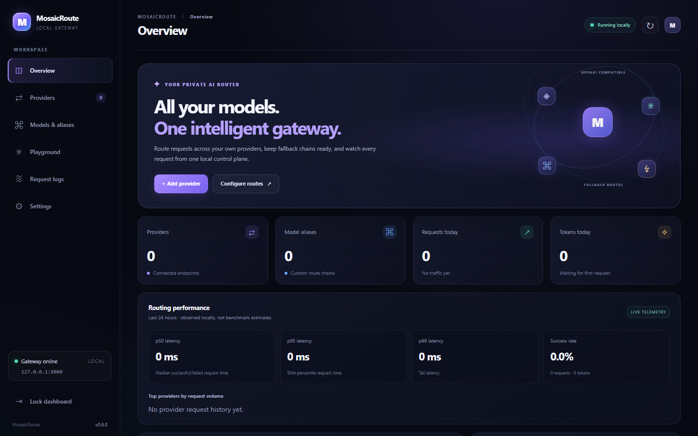
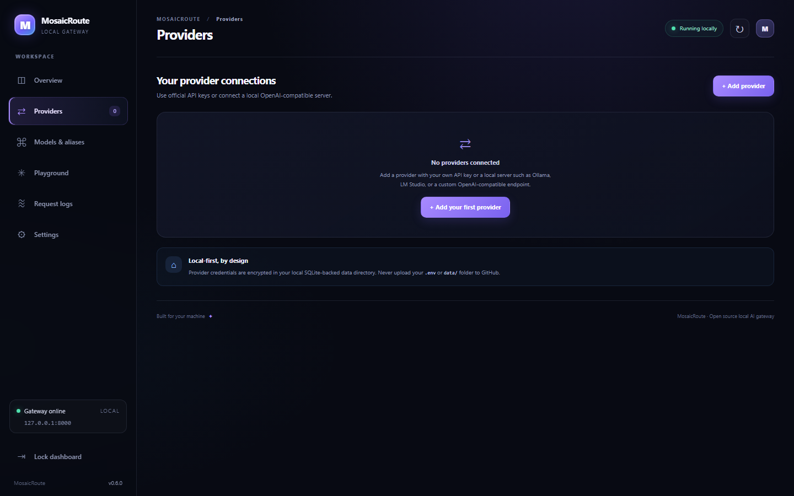
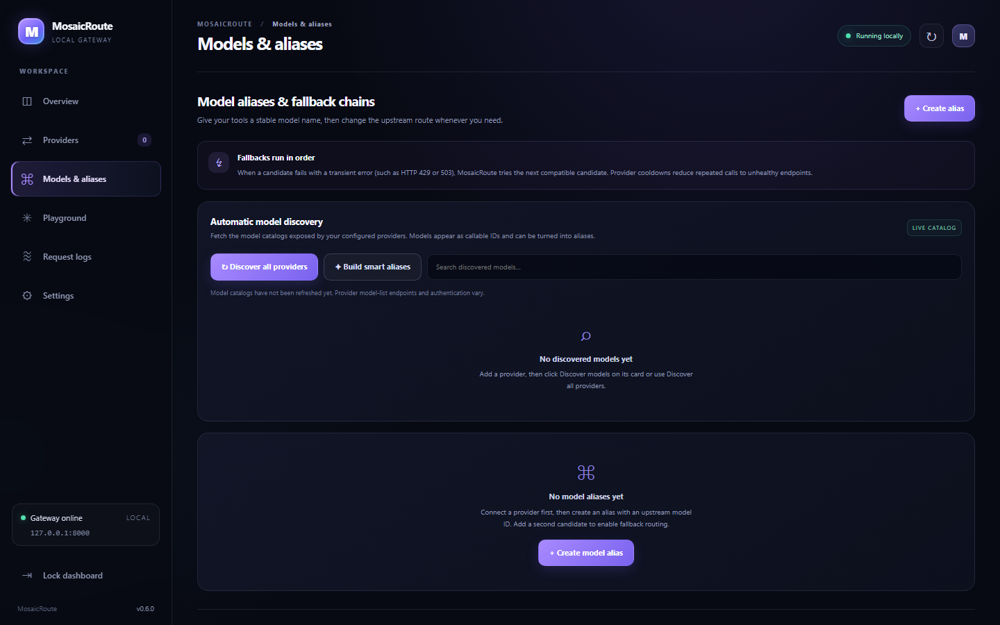
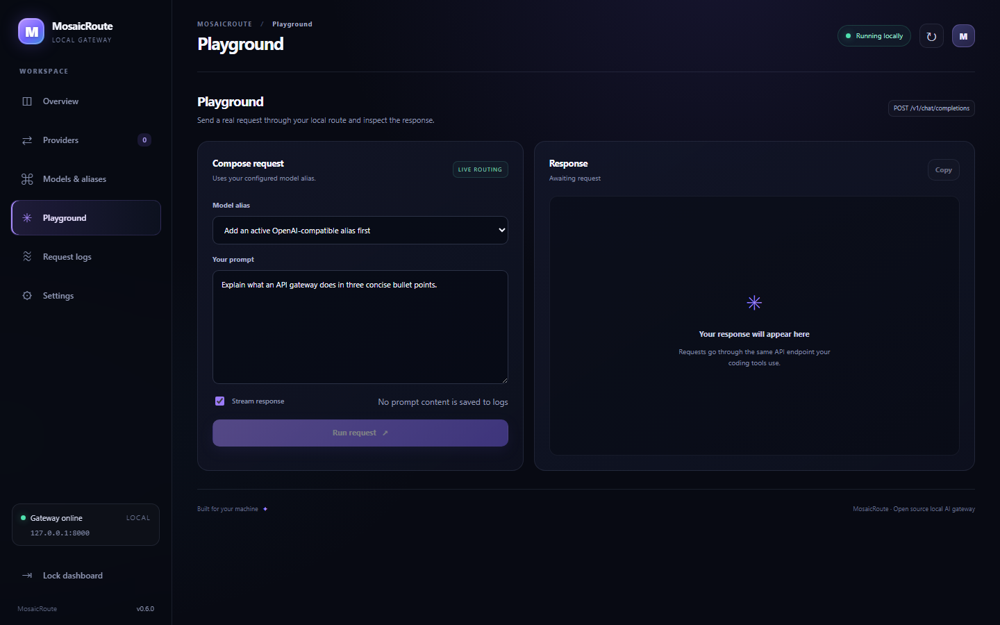
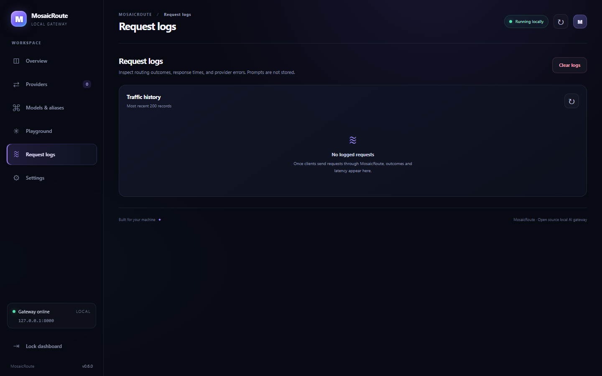
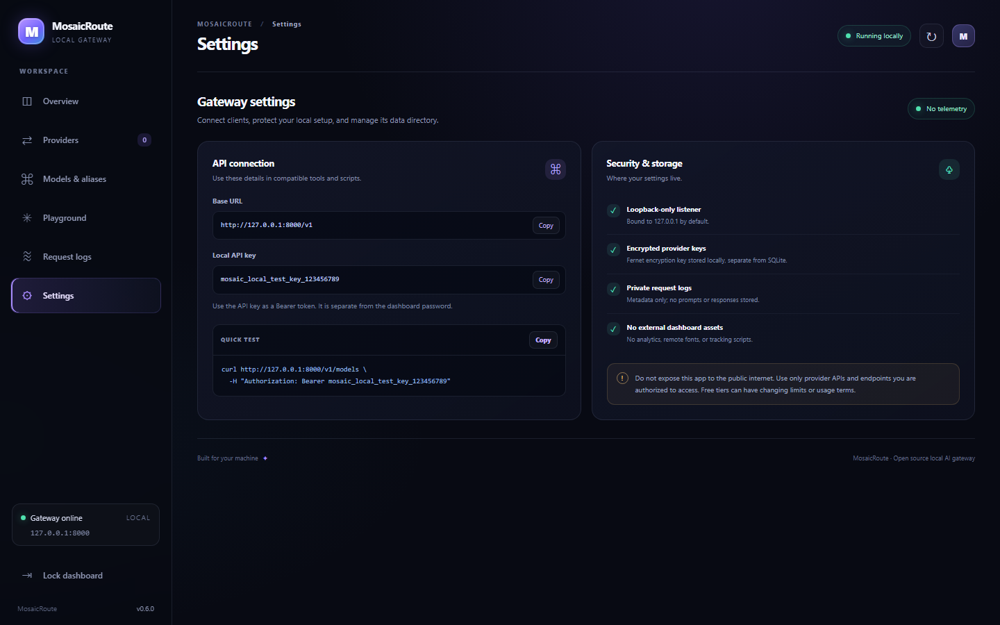
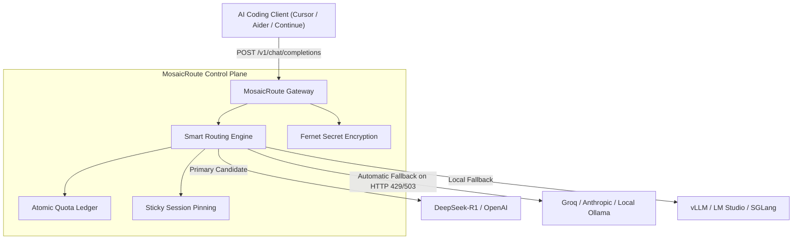

# 🌐 MosaicRoute

<div align="center">

<p align="center">
  <strong>Your Ultimate Local-First AI Gateway & Universal Model Router</strong>
</p>

<p align="center">
  <a href="#-features">Features</a> •
  <a href="#-architecture">Architecture</a> •
  <a href="#-supported-providers">112+ Providers</a> •
  <a href="#-live-gui-previews">UI Screenshots</a> •
  <a href="#-quick-start">Quick Start</a> •
  <a href="#-api-endpoints">API Reference</a>
</p>

<p align="center">
  
  
  
  
</p>

</div>

---

## 🎬 Live GUI Previews & Screenshots

> *Streamline all your coding agents (Cursor, Claude Dev, Roo Code, Aider, Continue) and chat apps through one lightning-fast local base URL with intelligent automatic failover.*

### 🖥️ Dashboard Overview
<div align="center">
  
</div>

---

### ⇄ Provider Connections & Presets
<div align="center">
  
</div>

---

### ⌘ Model Aliases & Auto Discovery
<div align="center">
  
</div>

---

### ✳️ AI Playground & Testing
<div align="center">
  
</div>

---

### ≋ Request Logs & Telemetry
<div align="center">
  
</div>

---

### ⚙️ Gateway Settings & Local API Key
<div align="center">
  
</div>

---

### 🎥 Video Walkthrough Recording
You can watch the full automated end-to-end GUI navigation and feature walkthrough recording:
👉 **[Watch Demo Recording (WebM)](media/videos/demo-walkthrough.webm)**

---

## ✨ What is MosaicRoute?

**MosaicRoute** is a zero-telemetry, self-hosted local AI gateway designed to unify all your Large Language Models under **a single OpenAI-compatible base URL** (`http://127.0.0.1:8000/v1`). 

Whether you are routing between commercial frontier APIs (OpenAI, Anthropic, Gemini, DeepSeek), aggregators (OpenRouter, Groq, Together), or private local runtimes (Ollama, LM Studio, vLLM, SGLang, KoboldCpp), MosaicRoute acts as your intelligent routing and reliability proxy.

---

## 🏗️ System Architecture



---

## 🚀 Key Features

- **⚡ 112+ Built-in Provider Presets:** Instant configuration templates for official APIs, fast inference providers, cloud enterprises, and local runtimes (`config/provider_catalog.json`).
- **🔄 Health-Aware Smart Routing:** Strategies including *Balanced* (success rate + latency history), *Most Reliable*, *Fastest Observed*, *Lowest Known Price*, *Round Robin*, and *Manual Priority*.
- **🛡️ Resilient Automatic Fallback:** Seamlessly retries transient upstream failures (`408`, `429`, `502`, `503`, `504` and auth drops) with exponential backoff and provider cooldowns.
- **🧬 Auto Model Discovery:** Scheduled and on-save model discovery that populates `/v1/models` without manual alias creation.
- **🎯 Generated Smart Aliases:** Auto-routes like `auto`, `auto/coding`, `auto/fast`, `auto/cheap`, `auto/free`, `auto/offline`, `auto/vision`, and `auto/long-context`.
- **🔐 Enterprise-Grade Local Security:** Fernet-encrypted keys at rest in SQLite, loopback-only binding (`127.0.0.1`), request metadata logging (prompts & response contents are never saved).
- **📊 Real-time Telemetry:** p50, p95, and p99 latency percentiles with per-provider and per-model request breakdowns.

---

## 📦 Installation & Getting Started

### Prerequisites
- **Python 3.11+** (Python 3.12 or 3.13 recommended)

### Windows
1. Clone or download the repository.
2. Double-click `install.bat` once to set up the virtual environment and dependencies.
3. Double-click `start.bat` to launch the server.
4. Copy the auto-generated **Dashboard Password** and **Local API Key** printed in the terminal.
5. Open **`http://127.0.0.1:8000`** in your browser.

### macOS / Linux
```bash
git clone https://github.com/Arhan-w/MosaicRoute.git
cd MosaicRoute
chmod +x install.sh start.sh
./install.sh
./start.sh
```
Note the credentials printed in your terminal and open **`http://127.0.0.1:8000`**.

---

## 🔌 Supported API Endpoints

MosaicRoute supports full pass-through for major AI wire protocols:

- `GET /v1/models` — List configured aliases and discovered upstream models.
- `GET /v1/models/{model_id}` — Inspect specific model metadata.
- `POST /v1/chat/completions` — OpenAI chat completions (streaming & non-streaming).
- `POST /v1/completions` — Legacy text completions.
- `POST /v1/messages` — Anthropic Messages API pass-through.
- `POST /v1/embeddings` — Vector embeddings.
- `POST /v1/audio/speech` — Text-to-speech audio bytes generation.
- `POST /v1/audio/transcriptions` — Whisper speech-to-text transcription.
- `POST /v1/images/generations` — DALL-E / FLUX image generation.
- `POST /v1/moderations` — Content moderation.

---

## 🤝 Contributing

Contributions are welcome! Please feel free to submit a Pull Request or open an issue for feature requests and bug reports.

1. Fork the Project (`https://github.com/Arhan-w/MosaicRoute/fork`)
2. Create your Feature Branch (`git checkout -b feature/AmazingFeature`)
3. Commit your Changes (`git commit -m 'Add some AmazingFeature'`)
4. Push to the Branch (`git push origin feature/AmazingFeature`)
5. Open a Pull Request

---

## 📄 License

Distributed under the **MIT License**. See `LICENSE` for more information.

<div align="center">
  <p>Built with ✦ for local-first AI control.</p>
</div>
